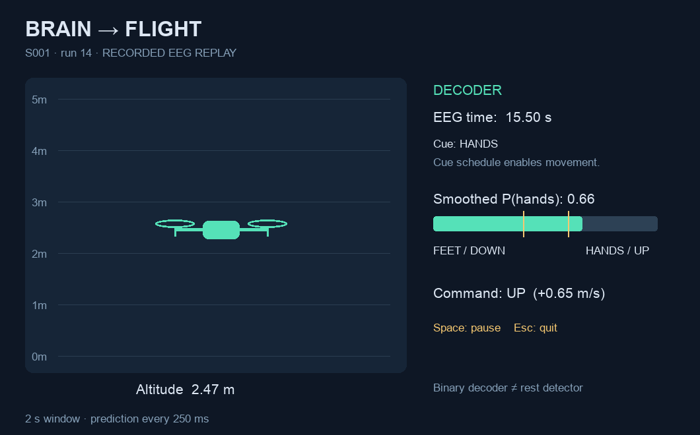

# EEG → Drone

Train a hands-versus-feet motor-imagery classifier on PhysioNet EEG, then replay
unseen EEG to move a simulated drone up and down. A 75–90 minute Python workshop.

**Students implement three functions.** Data loading, causal filtering, timed
replay, plotting, and a Pygame simulator are provided. A complete reference
solution is included for facilitators.



This is **real-time inference on a prerecorded participant**, not a live headset
or a physical drone. Movement is enabled only within known task periods. The
binary classifier does not recognize rest.

## Setup

Use **Python 3.11–3.13; 3.12 recommended**. Run commands from this folder.

```bash
python3.12 -m venv .venv
source .venv/bin/activate
python -m pip install -e '.[dev]'
```

`requirements-tested.txt` records the exact environment verified on Python 3.12.
To reproduce it, install that file before the editable package:
`python -m pip install -r requirements-tested.txt`, then the command above.

On Windows: `py -3.12 -m venv .venv`, then `.venv\Scripts\activate`.
Internet is needed for installation and the first EEG download. The simulator
opens a local desktop window, so a local terminal/editor is the easiest setup.

## Student path

```bash
eeg-drone prepare --subject 1
# Open artifacts/raw_eeg.png and src/eeg_drone/student.py.

# Implement Task 1, then:
eeg-drone check --task features

# Implement Task 2, then:
eeg-drone check --task model
eeg-drone train --subject 1
# Inspect artifacts/evaluation.png and artifacts/metrics.json.

# Implement Task 3, then:
eeg-drone check --task control
eeg-drone fly
```

Space pauses playback; Escape quits. Checks intentionally fail with a clear TODO
message until each student function is implemented. `eeg-drone check` runs all
three checks. `python -m eeg_drone ...` is equivalent to `eeg-drone ...`.

## Instructor demo

```bash
eeg-drone check --solution
eeg-drone prepare --subject 1
eeg-drone train --subject 1 --solution --output-dir artifacts/reference
eeg-drone fly --model artifacts/reference/model.joblib --output-dir artifacts/reference
```

The saved artifact records whether training used student or reference features;
`fly` automatically uses that implementation for features and commands. Keep
reference and student artifacts in separate folders. Retrain after changing
feature extraction or the channel/band settings. Load only trusted model files:
joblib uses pickle.

Fast replay with no display:

```bash
eeg-drone fly --model artifacts/reference/model.joblib --headless --speed 0 \
  --output-dir artifacts/reference --screenshot artifacts/reference/drone.png
```

## How the project works

```text
PhysioNet EDF ── MNE loader ── causal 7–30 Hz filter
                                      │
                      2-second windows, C3 / Cz / C4
                                      │
                     6 log powers: mu + beta per channel
                                      │
                      StandardScaler → logistic regression
                                      │
                             P(hands), every 250 ms
                                      │
                 cue gate → probability smoothing → deadband
                                      │
                    up / hover / down → Pygame drone
```

Runs **6 and 10 train** the model; **run 14 tests** it. These are imagined both
hands versus both feet, not left hand versus right hand and not actual movement.
Labels: `T1 = hands = 1`, `T2 = feet = 0`, `T0 = rest`.

The model only sees EEG-derived features. The cue schedule is used to create
training labels, evaluate results, and enable the demo controller. At inference,
the gate accepts a window only when the entire 2 seconds falls within one task
cue, after a 0.5-second onset delay. It does not tell the model which class to
predict. A confidence deadband is not a rest detector or a calibrated guarantee.

Training windows advance by 0.5 seconds; replay predictions advance by 0.25
seconds. Both use exactly the same channel order, units, filtering, and feature
function. Filtering includes rest and retains state across chunks. Playback
speed changes wall-clock time, not EEG timestamps or processing.

## Files to use

| File | Purpose |
| --- | --- |
| [student.py](src/eeg_drone/student.py) | Three student TODOs |
| [WORKSHOP.md](docs/WORKSHOP.md) | Task instructions and checkpoints |
| [QUESTIONS.md](docs/QUESTIONS.md) | High-level and code-comprehension questions |
| [ANSWER_KEY.md](docs/ANSWER_KEY.md) | Instructor answers and discussion notes |
| [FACILITATOR.md](docs/FACILITATOR.md) | Meeting schedule, prep, troubleshooting |
| [solution.py](src/eeg_drone/solution.py) | Complete reference functions |
| [replay.py](src/eeg_drone/replay.py) | Chunk processing and rolling windows |
| [signal.py](src/eeg_drone/signal.py) | Causal filtering and training windows |
| [control.py](src/eeg_drone/control.py) | Smoothing, rest gating, drone dynamics |
| [simulator.py](src/eeg_drone/simulator.py) | Pygame view and replay loop |

Generated files live under `artifacts/`: raw EEG plot, evaluation plot, model,
metrics, replay CSV, and replay summary. EEG downloads live under `data/`. Both
folders are ignored by Git. The model is a small within-person baseline; it is
not validated on new people, a new session, or your own headset.

## Verification

```bash
pytest -q                         # synthetic checks; no EEG download
pytest -q --integration           # also train/reload/replay real PhysioNet EEG
```

Tests check filter-state continuity, no future-sample access, cue boundaries,
offline/streaming prediction agreement, and control behavior. They do not demand
an arbitrary accuracy on biological data. They exercise the reference solution
and provided infrastructure; use `eeg-drone check` for your student functions.
See [VALIDATION.md](docs/VALIDATION.md)
for the measured reference run.

## Sources

- [PhysioNet EEG Motor Movement/Imagery Dataset, v1.0.0](https://physionet.org/content/eegmmidb/1.0.0/), Schalk (2009), DOI: [10.13026/C28G6P](https://doi.org/10.13026/C28G6P). The recordings remain subject to their [Open Data Commons Attribution License](https://physionet.org/content/eegmmidb/view-license/1.0.0/); they are downloaded separately, not bundled here.
- [MNE hands/feet motor-imagery example](https://mne.tools/stable/auto_examples/decoding/decoding_csp_eeg.html). This repo uses a simpler band-power/logistic-regression model and causal filtering rather than copying its CSP/LDA pipeline.
- [SciPy stateful SOS filtering](https://docs.scipy.org/doc/scipy/reference/generated/scipy.signal.sosfilt.html), [scikit-learn logistic regression](https://scikit-learn.org/stable/modules/generated/sklearn.linear_model.LogisticRegression.html), [Pygame](https://www.pygame.org/docs/).
- Later hardware extension: [MNE-LSL PlayerLSL](https://mne.tools/mne-lsl/stable/generated/api/mne_lsl.player.PlayerLSL.html).
